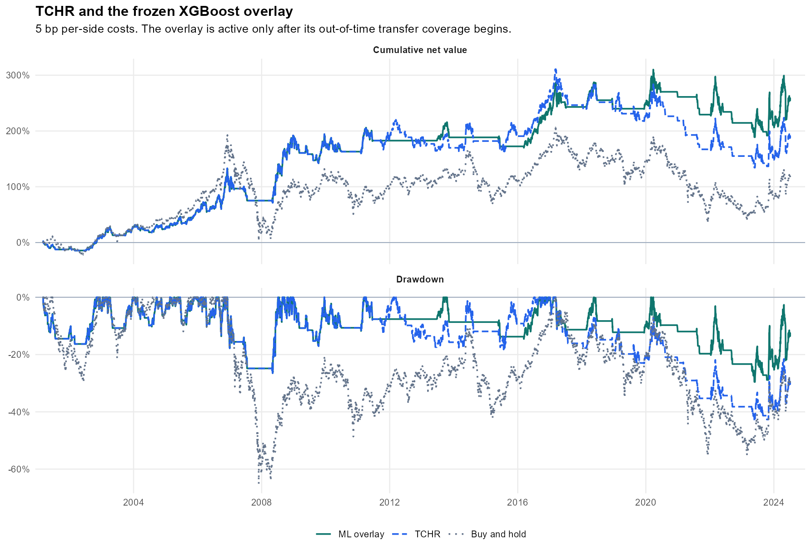
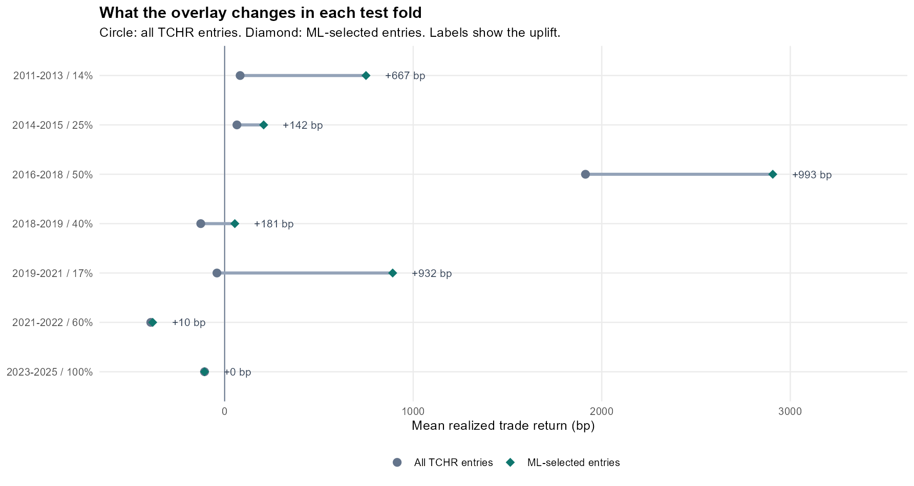
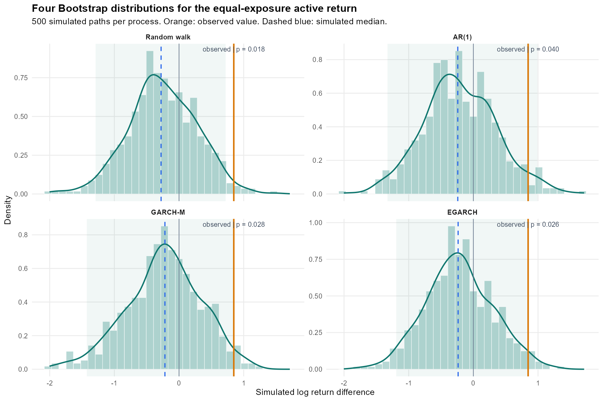
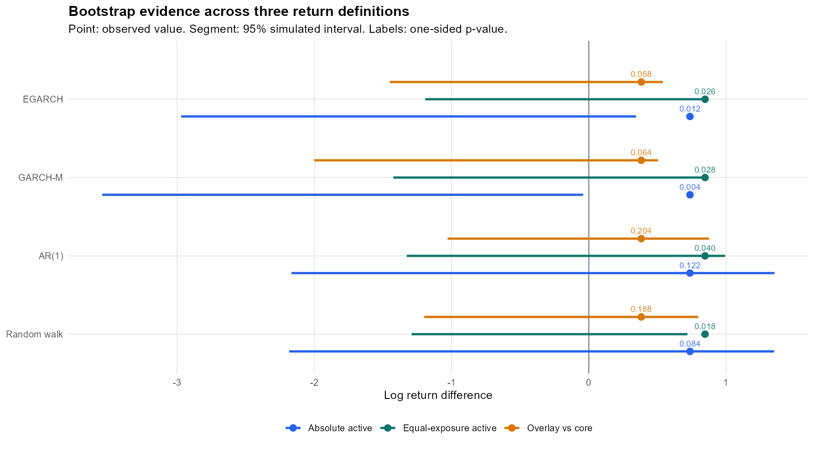

# Trend-Confirmed Hammer Reversal (TCHR)

**A Bootstrap-based statistical validation of a Hang Seng Index trading strategy**

I developed **Trend-Confirmed Hammer Reversal (TCHR)** by combining a 100-day trend filter, a hammer reversal setup, close confirmation, and next-session execution. The strategy uses a 1% trend buffer, holds a confirmed position for up to 10 sessions, and exits when the pattern low or trend support is lost.

The main contribution is the statistical validation layer. I generate feasible OHLC paths under four calibrated processes, rerun TCHR on every path, and compare the observed result with null distributions, circular block intervals, and a max-t correction across 51 candidate rules.

**[Read the English research report](strategy/report-en.html)** · [Chinese report](strategy/report.html)

## Fixed historical sample

The study covers **2001-03-01 to 2025-05-30** with 5,973 trading sessions. The first 220 sessions provide indicator warm-up. The primary cost scenario is 5 basis points per side.

| Measure | TCHR | Hang Seng buy-and-hold |
| --- | ---: | ---: |
| Net compound return | **+173.89%** | +58.31% |
| Maximum drawdown | −43.25% | −65.18% |
| Net return spread | **+115.58 percentage points** | — |

## Statistical validation

I run four Bootstrap-style null models on the same fixed window.

- **Random Walk Bootstrap** resamples empirical daily returns while removing their time order.
- **AR(1) Bootstrap** preserves first-order return dependence and resamples fitted innovations.
- **Student-t GARCH-M Bootstrap** preserves conditional volatility and the risk–return term.
- **EGARCH Bootstrap** preserves asymmetric volatility responses and selects the higher-likelihood converged fit.

Every path receives a valid OHLC reconstruction, a fresh TCHR run, a same-path buy-and-hold benchmark, and the corresponding ablation strategies. The statistical outputs include net return, active return versus the index, equal-exposure return, hammer-line increment, Monte Carlo intervals, and a circular block max-t correction across the full candidate set.

## Machine-learning TCHR overlay

I added a frozen XGBoost quality filter to TCHR entry events. The model is selected with purged walk-forward validation, calibrated only from past TCHR entries, and applied to seven out-of-time test folds. The transfer audit covers 36 TCHR entries with a mean realized trade-net uplift of **+417.94 bp**, a bootstrap lower bound of **+143.74 bp**, and a same-fold random-selection p-value of **0.0097**.

The frozen overlay is then applied to 500 paths from each of the four Bootstrap processes. Equal-exposure active return remains positive with a one-sided p-value below 0.05 under all four processes. The implementation and complete result tables are documented in the [TCHR ML overlay](strategy/ML_OVERLAY.md).

## Visual evidence

The updated presentation focuses on the frozen XGBoost overlay and its out-of-time validation.

The equity and drawdown panels compare the base TCHR strategy, the ML overlay, and buy-and-hold across the fixed window.

Each point pair shows how ML selection changes realized trade returns in each purged test fold.

The four panels place observed equal-exposure active return against 500 simulated paths for each process.

The interval view reports observed values, 95% simulated intervals, and one-sided p-values for absolute active, equal-exposure active, and overlay-versus-core returns.

## Reproducibility

| Evidence | File |
| --- | --- |
| TCHR definition, execution ledger, and fee model | [Fixed protocol](strategy/fixed/protocol.md) · [R engine](strategy/engine.R) |
| Net returns, risk, and cost scenarios | [Performance table](strategy/fixed/results/performance.csv) · [TCHR trades](strategy/fixed/results/tchr_trades.csv) |
| Bootstrap model outputs | [Tail probabilities](strategy/fixed/results/model_tail_tests.csv) · [Simulated paths](strategy/fixed/results/model_paths.csv) |
| Candidate-family correction | [Max-t results](strategy/fixed/results/simultaneous_rule_test.csv) |
| Inputs and historical materials | [Data notes](data/README.md) · [Archive notes](archive/README.md) |

~~~sh
Rscript --vanilla strategy/run-fixed.R
Rscript --vanilla strategy/run-fixed.R verify
~~~

The extended input data and earlier presentation assets remain in the archive. The public study uses the fixed window above.

## 中文补充

我建立了 TCHR 趋势确认锤头线反转策略，并在统一历史窗口内完成回测、四种 Bootstrap 随机性检验、区块自助法区间和候选规则族校正。英文报告是 GitHub 的默认展示入口，中文报告保留完整的中文说明。
