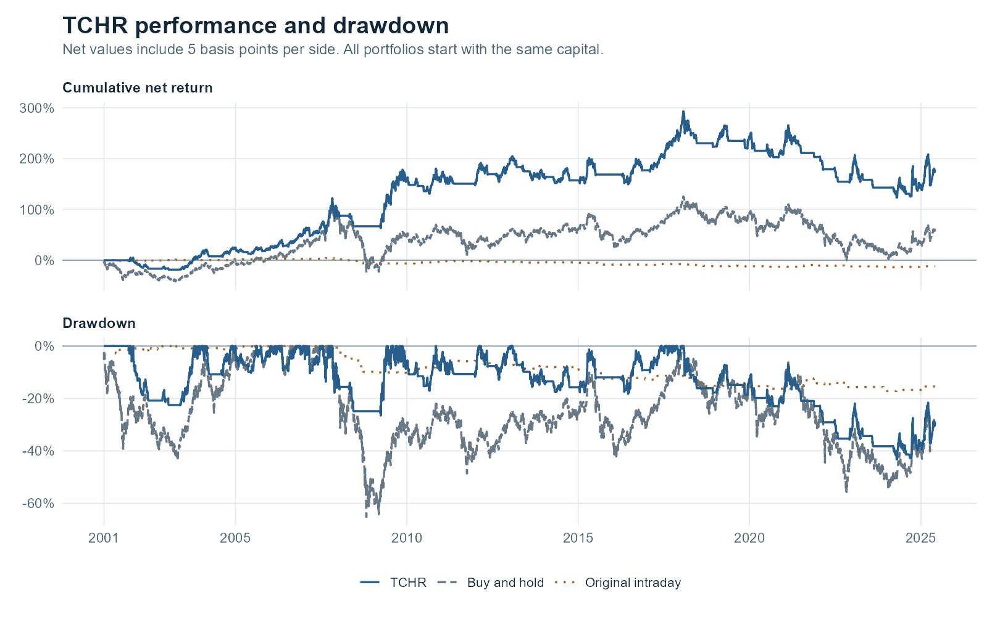
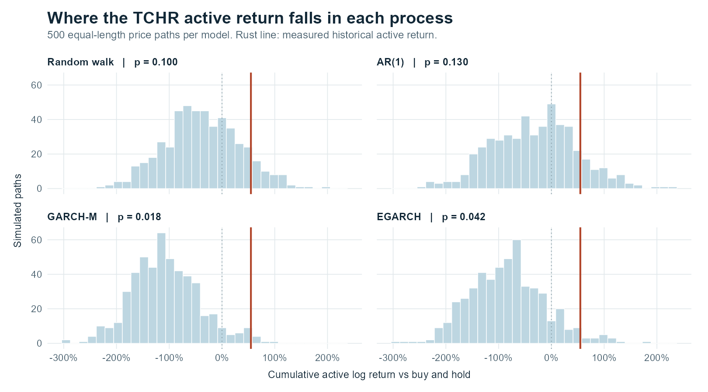
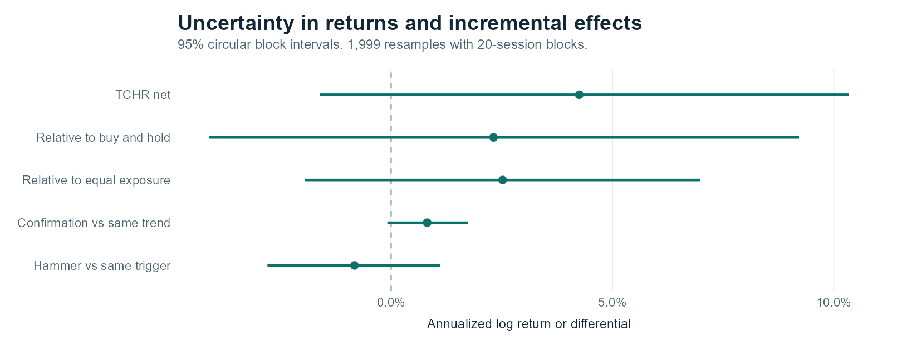
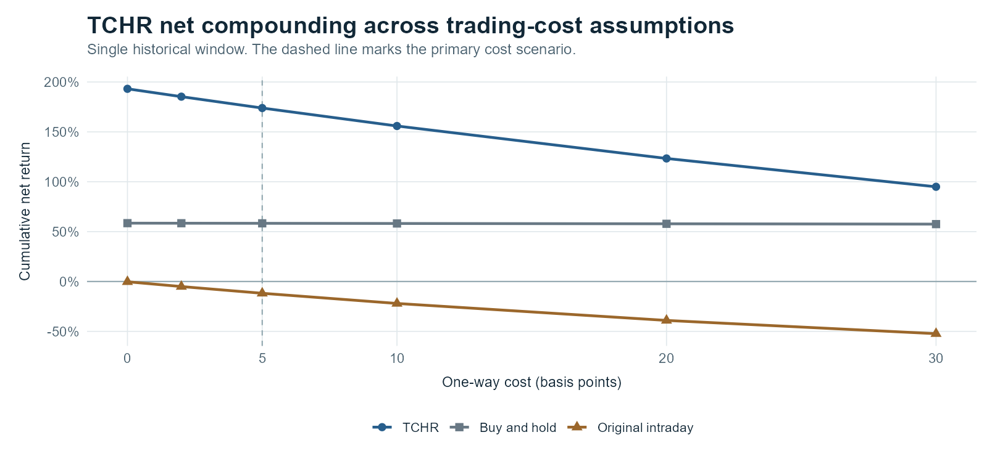

# Trend-Confirmed Hammer Reversal (TCHR)

**A Bootstrap-based statistical validation of a Hang Seng Index trading strategy**

I developed **Trend-Confirmed Hammer Reversal (TCHR)** by combining a 100-day trend buffer, a hammer reversal setup, close confirmation, and next-session execution. The strategy uses a 1% trend buffer, holds a confirmed position for up to 10 sessions, and exits when the pattern low or trend support is lost.

I focus on the statistical validation chain. I reconstruct feasible OHLC paths under four Bootstrap-style processes, rerun TCHR on every path, and compare the observed result with null distributions, circular block intervals, and a max-t correction across the candidate family.

**[Read the English TCHR report](strategy/report-en.html)** · [Chinese report](strategy/report.html)

## Fixed historical sample

The fixed sample covers **2001-03-01 to 2025-05-30** with 5,973 sessions. The first 220 sessions provide indicator warm-up. The primary cost is 5 basis points per side.

| Measure | TCHR | Hang Seng buy-and-hold |
| --- | ---: | ---: |
| Net compound return | **+173.89%** | +58.31% |
| Maximum drawdown | −43.25% | −65.18% |
| Net return spread | **+115.58 percentage points** | — |

## Statistical validation

I run four Bootstrap-style null models on the same fixed window.

- **Random Walk Bootstrap** resamples empirical daily returns while removing their time order.
- **AR(1) Bootstrap** preserves first-order return dependence and resamples fitted innovations.
- **Student-t GARCH-M Bootstrap** preserves conditional volatility and the risk–return term.
- **EGARCH Bootstrap** preserves asymmetric volatility responses and compares converged optimizer solutions.

I rerun TCHR, buy-and-hold, and the ablation strategies on every path. The outputs cover net return, active return, equal-exposure return, and the hammer-line increment. A shared circular block max-t correction covers all 51 candidate rules.

## Visual evidence

TCHR wealth and drawdown over the fixed historical sample.

The observed TCHR active return inside four Bootstrap null distributions.

Circular block intervals for TCHR returns and incremental effects.

TCHR net compounding under alternative one-way cost assumptions.

## Reproducibility

| Evidence | File |
| --- | --- |
| TCHR definition, execution ledger, and fee model | [Fixed protocol](strategy/fixed/protocol.md) · [R engine](strategy/engine.R) |
| Net returns, risk, and cost scenarios | [Performance table](strategy/fixed/results/performance.csv) · [TCHR trades](strategy/fixed/results/tchr_trades.csv) |
| Bootstrap model outputs | [Tail probabilities](strategy/fixed/results/model_tail_tests.csv) · [Simulated paths](strategy/fixed/results/model_paths.csv) |
| Candidate-family correction | [Max-t results](strategy/fixed/results/simultaneous_rule_test.csv) |
| Inputs and historical materials | [Data notes](data/README.md) · [Archive notes](archive/README.md) |

~~~sh
Rscript --vanilla strategy/run-fixed.R
Rscript --vanilla strategy/run-fixed.R verify
~~~

The extended input and earlier presentation assets remain in the archive. The public entry point uses the fixed 2025-05-30 sample.
